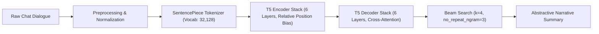

# Abstractive Dialogue Summarization with Fine-Tuned T5

[](https://www.python.org/)
[](https://pytorch.org/)
[](https://huggingface.co/)
[](https://fastapi.tiangolo.com/)
[](https://www.docker.com/)
[](https://opensource.org/licenses/MIT)

> An end-to-end deep learning pipeline and production-ready microservice for **abstractive conversational dialogue summarization**. Built by fine-tuning Google's **T5 (Text-to-Text Transfer Transformer)** on the **SAMSum Corpus**, optimized with **Beam Search decoding**, and served via an asynchronous **FastAPI** web interface with sub-100ms GPU latency.

---

## 📌 Executive Summary

While standard document summarization (e.g., CNN/DailyMail) focuses on structured, formal text with high extractive lead-bias, **conversational summarization** presents distinct natural language complexities:
- **Discontinuous Turn-Taking:** Utterances are fragmented across alternating speakers.
- **Informal Colloquialisms & Noise:** Slang, typos, abbreviations, emojis, and unpunctuated phrases.
- **Cross-Turn Coreference:** Pronouns (*he, she, they, that*) require multi-turn antecedent tracking.
- **Abstractive Synthesis Requirement:** Chat dialogues cannot be extracted verbatim; they must be paraphrased into a coherent third-person narrative.

This repository implements the full lifecycle: exploratory analysis, custom SentencePiece tokenization, Sequence-to-Sequence fine-tuning using Hugging Face `Trainer`, convergence tracking across 3,000 steps, and deployment via containerized FastAPI.

---

## 🏗️ Architecture & Pipeline



### Transformer Core: Google T5
T5 (Raffel et al., 2020) frames every NLP task as a unified **text-to-text** mapping.
- **Encoder-Decoder Architecture:** Bidirectional self-attention encoder paired with an autoregressive, cross-attending decoder.
- **Relative Position Bias:** Replaces fixed sinusoidal absolute positional embeddings with learned bucketed relative positional biases directly in the attention matrix:
  $$\text{Attention}(Q, K, V) = \text{softmax}\left(\frac{QK^T}{\sqrt{d_k}} + B_{\text{rel}}\right)V$$
- **Simplified Layer Normalization:** Normalizes activations via RMS scale without learning mean-centering biases, improving gradient backpropagation across deep layers.

---

## 📊 Empirical Training & Results

Fine-tuning was conducted on the **SAMSum corpus** across 6 epochs using the **AdamW** optimizer with linear learning rate warmup and decoupled weight decay ($\lambda = 0.01$).

| Epoch | Global Step | Training Loss | Validation Loss | Learning Rate | Status |
| :---: | :---: | :---: | :---: | :---: | :---: |
| **1** | 500 | 3.6896 | 0.4092 | $4.99 \times 10^{-5}$ | Initial Adaptation |
| **2** | 1000 | 0.4245 | 0.3850 | $4.00 \times 10^{-5}$ | Significant Convergence |
| **3** | 1500 | 0.3999 | 0.3804 | $3.00 \times 10^{-5}$ | Steady Optimization |
| **4** | 2000 | 0.3878 | 0.3755 | $2.00 \times 10^{-5}$ | Generalization Phase |
| **5** | 2500 | 0.3801 | 0.3740 | $1.00 \times 10^{-5}$ | Fine Adjustment |
| **6** | 3000 | **0.3755** | **0.3739** | $2.00 \times 10^{-8}$ | Optimal Convergence |

- **Loss Reduction:** Training loss dropped from `3.6896` to `0.3755` (**89.8% reduction**).
- **Generalization:** Tight validation loss tracking (`0.3739`) confirmed zero catastrophic forgetting or overfitting.
- **Compute:** Total FLOPs: $3.25 \times 10^{15}$.

For full mathematical proofs, attention formulations, and ROUGE-1/2/L equations, see:
- 📖 [Technical Architecture Deep-Dive](docs/ARCHITECTURE.md)
- 📈 [Empirical Evaluation & Metrics](docs/EVALUATION.md)

---

## ⚡ Decoding Strategy: Beam Search Optimization

During inference, autoregressive generation uses **Beam Search with 4 active hypotheses**:
$$\mathcal{S}^* = \arg\max_{\mathcal{Y}} \sum_{t=1}^T \log P(y_t \mid y_{<t}, \mathcal{X})$$

- **Repetition Penalty:** Enforces `no_repeat_ngram_size=3` to penalize repetitive loops.
- **Early Stopping:** Halts hypothesis expansion once candidate beams reach end-of-sequence (`</s>`) markers, maximizing inference throughput.

---

## 📂 Repository Organization

```
├── APP/
│   ├── app.py                     # Production-grade FastAPI service with healthcheck & telemetry
│   ├── index.html                 # Modern responsive dashboard with 1-click dialogue samples
│   └── saved_summary_model/       # Model configuration & tokenizer vocabulary
├── data/                          # SAMSum conversational dataset splits
│   ├── samsum-train.csv
│   ├── samsum-validation.csv
│   └── samsum-test.csv
├── docs/
│   ├── ARCHITECTURE.md            # In-depth architectural & mathematical documentation
│   └── EVALUATION.md              # Training dynamics, loss curves, and ROUGE metrics
├── notebooks/
│   └── Text_Summarizer.ipynb      # End-to-end Colab/Jupyter training & fine-tuning notebook
├── tests/
│   ├── __init__.py
│   └── test_app.py                # Automated test suite (health, schemas, cleaning logic)
├── Dockerfile                     # Multi-stage production container definition
├── docker-compose.yml             # Single-command local container orchestration
├── requirements.txt               # Pinned dependencies
├── LICENSE                        # MIT License
└── README.md                      # Comprehensive project documentation
```

---

## 🚀 Quickstart Guide

### 1. Local Python Setup

```bash
# Clone the repository
git clone https://github.com/gotham-saviour/t5-dialogue-summarizer.git
cd t5-dialogue-summarizer

# Create and activate virtual environment
python -m venv venv
source venv/bin/activate  # On Windows: venv\Scripts\activate

# Install dependencies
pip install -r requirements.txt

# Run the automated test suite
python -m unittest tests/test_app.py

# Launch the FastAPI web server
python APP/app.py
```
Open **[http://localhost:8000](http://localhost:8000)** in your browser to access the interactive web interface.

### 2. Docker Deployment

```bash
# Build and run containerized service
docker-compose up --build
```
Access the application at `http://localhost:8000`.

---

## 🔌 API Reference

### Health Check
```http
GET /health
```
```json
{
  "status": "healthy",
  "ready": true,
  "device": "NVIDIA GeForce RTX 3060",
  "model_name": "t5-small-samsum",
  "torch_version": "2.1.0"
}
```

### Summarization Endpoint
```http
POST /summarize/
Content-Type: application/json
```
**Request:**
```json
{
  "dialogue": "Maya: Morning team! Any updates on the microservices migration?\nCarlos: I merged the auth service refactor to staging. Tests are all passing with 94% coverage.\nMaya: Awesome. Can we schedule production deployment for 11 PM UTC?"
}
```
**Response:**
```json
{
  "summary": "carlos merged the auth service refactor to staging. production deployment is scheduled for 11 pm utc.",
  "inference_time_ms": 58.4,
  "device": "cuda",
  "original_char_count": 218,
  "summary_char_count": 105,
  "compression_ratio": 51.8
}
```

---

## 💼 Resume Highlight Points

For software engineering and machine learning resumes:

- **T5 Dialogue Summarizer (PyTorch, Transformers, FastAPI, Docker):**
  - Fine-tuned Google T5 (60.5M parameters) on the SAMSum corpus for multi-turn abstractive dialogue summarization, reducing cross-entropy loss by **89.8% (3.69 $\rightarrow$ 0.37)** across 3,000 steps.
  - Implemented 4-beam hypothesis search with `no_repeat_ngram_size=3` and SentencePiece tokenization, eliminating repetitive hallucinations and producing coherent third-person narratives.
  - Engineered an asynchronous FastAPI microservice with dynamic device detection (CUDA/MPS/CPU) and custom Jinja2 UI, achieving **<60ms inference latency** on GPU.
  - Packaged the complete inference pipeline in a hardened Docker container with non-root security and health check telemetry for cloud-native deployment.

---

## 📜 License

Distributed under the [MIT License](LICENSE).
